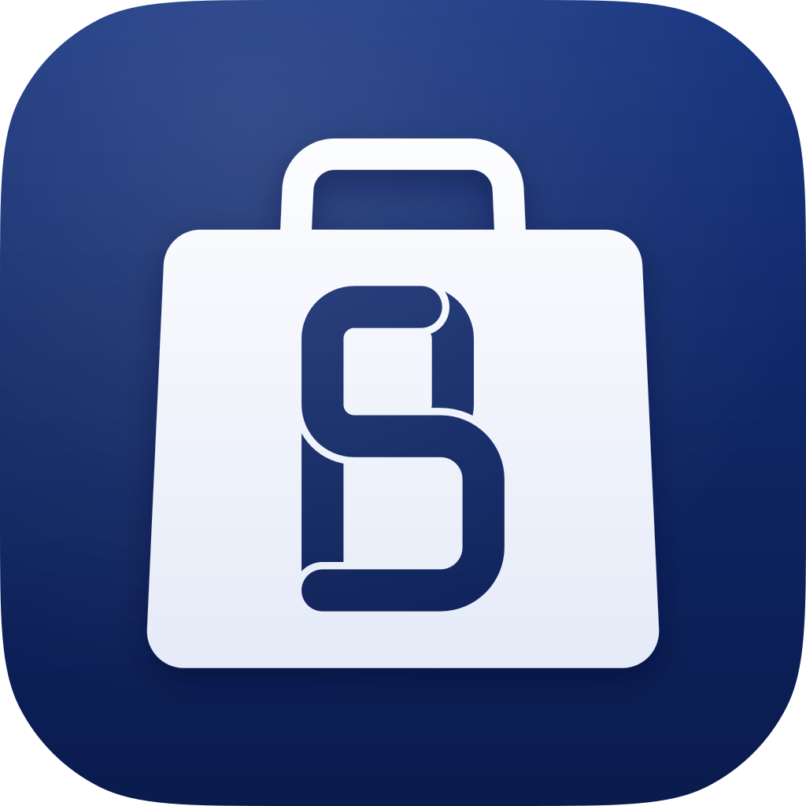

<p align="center"></p>

<h1 align="center">BariStore</h1>

<p align="center"><b>An app store for iPhone and iPad that needs no computer.</b><br>
Install, refresh and update sideloaded apps with a free Apple ID, on the device you hold.</p>

<p align="center"><a href="https://barismd.github.io/BariStore/">Website</a> ·
<a href="#install">Install</a> ·
<a href="https://github.com/barismd/BariStore/releases/latest">Latest release</a></p>

<p align="center">
&nbsp;
&nbsp;

</p>

## Why BariStore

- **No computer, no second device.** Pairing, signing and installing all happen on the iPhone or iPad itself.
- **Developer Mode does not need to have been on.** Pairing makes it appear in Settings; BariStore shows where to tap.
- **Uses none of your 3 app slots.** It runs inside [Open Minis](https://apps.apple.com/app/id6759188481) and works like an App Store app.
- **Refresh in seconds.** A refresh renews the apps' profiles: nothing is downloaded, signed or uploaded again (apps signed with an older certificate are signed again).
- **JIT with one tap** for emulators and other JIT apps, right from BariStore.
- **Sources and updates.** App sources, any IPA from Files (a newer build of one updates it in place), one-tap updates, and per-app beta tracks (Off, nightly, alpha…).
- **Fast on the device.** Hashing runs on the processor's SHA instructions and signing uses every core.
- **Your App IDs under control.** See what uses each one, reuse the App IDs of deleted apps or type your own, keep or drop extensions, ask for Increased Memory Limit (later too: an update keeps it).
- **Your own app icons.** Pick any picture as an app's icon when you install it, or change it later.
- **Install into LiveContainer.** Send an app from Featured or an IPA from Files straight into LiveContainer; an app from one of your sources arrives with its source.
- **Works with the other tools.** SideStore, AltStore, LiveContainer + SideStore and StikDebug get the pairing file; the stores and LiveContainer get the signing certificate, so they can refresh themselves too.

## Install

You need an iPhone or iPad on **iOS 27 or newer**, **Open Minis** and **[LocalDevVPN](https://apps.apple.com/app/id6755608044)**
from the App Store, a **free Apple ID** and **Wi-Fi** with LocalDevVPN connected.

Paste this into Open Minis's terminal:

```sh
wget -qO- https://barismd.github.io/BariStore/install.sh | sh
```

The store opens and walks you through the rest:

1. **Pair.** Settings › Privacy & Security › Developer Mode shows **Pair with BariStore**: tap it, enter your
   passcode and type the code from the notification.
2. **Sign in** with your Apple ID (two-factor codes included).
3. **Install** from Featured, or add any IPA.

Next time, type `baristore`. Updates come through My Apps › Updates; Options › Log gives a report to share when
something goes wrong.

## Safe by design

- **Your password never leaves your device** and is never saved: Apple's sign-in turns it into a one-time proof on the device.
- **There is no BariStore server.** No accounts, no analytics. BariStore talks only to Apple, an anisette server and the sources you add.
- **The anisette server never sees your Apple ID.** It only supplies device-identity data from a random identifier. Options › Anisette server lets you pick one or add your own.
- **Open source.** BariStore (MIT), Open Minis and the stores it offers (SideStore, LiveContainer, AltStore) are all open source.
- **Your keys stay with you.** The pairing record, session and signing key are stored privately inside Open Minis.

## Free Apple ID limits (Apple's)

Apps last **7 days** (Refresh all renews them), **3** apps at a time (BariStore does not count; LiveContainer runs
many apps inside one), **10** App IDs per 7 days (each app extension needs one; "Remove extensions" saves them).

## Build

One static Rust binary for Open Minis (aarch64 musl): `./scripts/build.sh` (needs `pip install ziglang`), tests with
`cargo test`. How it works and what has been verified on a device: [AGENTS.md](AGENTS.md).

## Licence

MIT, see [LICENSE](LICENSE). Third-party notices: [THIRD_PARTY_NOTICES.md](THIRD_PARTY_NOTICES.md).
Not affiliated with Apple.
